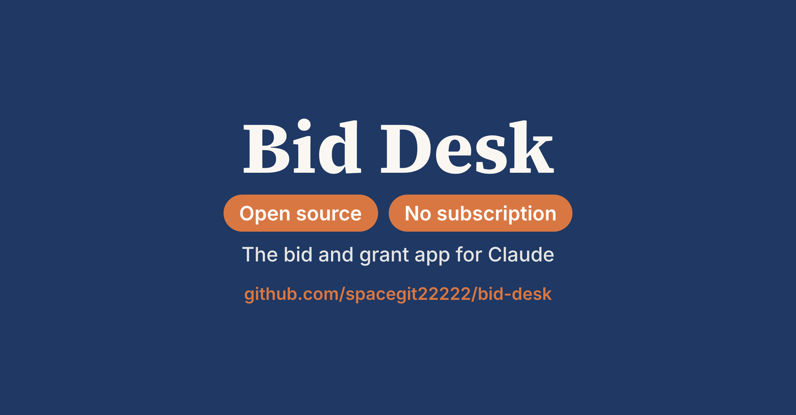

# Bid Desk

**An open-source bid and grant app for Claude.** No subscription, no licence fee.

Bids and grants are hard, and most of the hard parts are admin. Bid Desk lets Claude do the admin so your team can spend the time with clients:

- **Go/no-go on your own criteria.** Bid Desk fills your own checklist from the tender and your content library, with a source on every line.
- **Written from your own library.** Sections are drafted from your own company facts, references, CVs and methods, with every line traceable and the gaps listed.
- **The buyer's template, filled.** Text and prices go into the buyer's own Word and Excel forms, keeping their headings, tables and formulas.

It also tracks every tender and funding call on one board, checks eligibility and key terms against their pages, keeps one set of bid facts across every section, builds the price or grant budget (the app does the sums, not the AI), and turns every debrief into a view of where you lose points. It works for tenders and for grant applications. Writing grant applications? See the [guide for grant writers](docs/GRANTS.md).

Bid Desk runs as an artifact in your own Claude account. There is nothing to install.

## Set it up (about 15 minutes)

1. **Get the files.** Download this repository as a ZIP (green *Code* button, *Download ZIP*) and unzip it.
2. **Publish your own copy.** In Claude, start a new chat, attach all the files from the `bid-desk` folder and paste this prompt:

   > Publish the attached Bid Desk folder as an Artifact in my account. Give it the shared database, Claude, downloads and user capabilities, so my team can share bids and one content library.

   Claude publishes Bid Desk as a private artifact and gives you a link. Open it.
3. **Fill the content library once.** Open *Content library* and add:
   - your company profile
   - two or three references (client, scope, period, value, results, and whether the client agreed to be named)
   - short CVs for the roles you usually bid
   - your rate card, one role per line, written as `Role: EUR 950 per day`
   - cost norms for travel, meetings and translation
   - your go/no-go criteria as a **Go/no-go** item (tenders) or a **Fit check** item (grants), one criterion per line
   - two or three past winning answers as **Style** items, so drafts sound like your team

   Tag each item for tenders, grants or both. The AI drafts and prices only from what is in the library.
4. **Run your first tender or grant call.** Put your name in *Signed in as*, then choose *New opportunity* and upload a tender PDF (text-based PDFs work best). The sample grant call is there to try things out.
5. **Share it with your team.** See below.

A setup video and a full walkthrough are on [www.practical-ai.work/rfp-writing](https://www.practical-ai.work/rfp-writing).

## Working as a team

There is no shared Claude account. Each person uses their own.

- **One person owns your Bid Desk.** Whoever publishes it in step 2 is the owner. Your bids and content library are stored with that copy, so pick someone who will stay in the role, ideally on your organisation's Claude Team or Enterprise plan.
- **Invite colleagues from the Share menu in Claude.** Give the people who work on bids edit access; people with view access can read but not save. Colleagues open the same link in their own Claude account and see the same board, library and bids.
- **AI features use each person's own Claude plan.** The first time someone asks Bid Desk to draft or fill something, Claude asks them to allow it.
- **Last save wins.** If two people edit the same bid at the same moment, the last save is kept. Agree who owns each section; the *Who owes what* card helps.
- **Make a backup regularly.** *Content library > Export backup* saves the library and all bids as one file. *Import backup* restores it into any copy of Bid Desk, for example if the owner changes or you start a fresh copy. Tender PDFs are not stored: each person attaches them once in their own browser.
- **When someone leaves,** remove their access in the Share menu. If the owner leaves, export a backup first, publish a new copy under the new owner and import the backup.

## Good to know

- **Check your AI policy** before adding client documents, pricing or CVs. Use a Claude business plan that does not train on your data.
- **People decide.** Bid Desk prepares the analysis; whether to bid, the price and the final text stay with your team. Check every AI answer against its source.
- **Dutch tenders welcome.** The AI reads and drafts in Dutch and English; have a native speaker do the final edit.

## Samples

- **Sample grant call:** the funder (Fonds Groene Wijken), its call and the applicant (Stichting Buurtklimaat Utrecht) are fictional and included in full.
- **Sample tender:** WHO Indonesia RFP 079-2026 is a real public tender. Its pages are not included in this repository; download it from WHO to try it. The bidder (Northlight Data Advisory), its library and the WHO Word and Excel templates were made for the demo.
- **Sample outputs** in `docs/`: a filled go/no-go checklist and a filled fit check.

## Licence

MIT. See [LICENSE](LICENSE). Third-party libraries and fonts keep their own licences; see [THIRD_PARTY_NOTICES.md](THIRD_PARTY_NOTICES.md).

Claude is a trademark of Anthropic. Bid Desk is an independent project, not affiliated with or endorsed by Anthropic.

## Help

Want Bid Desk set up on your own tenders and content, with your team trained on a live bid? See [www.practical-ai.work](https://www.practical-ai.work).
